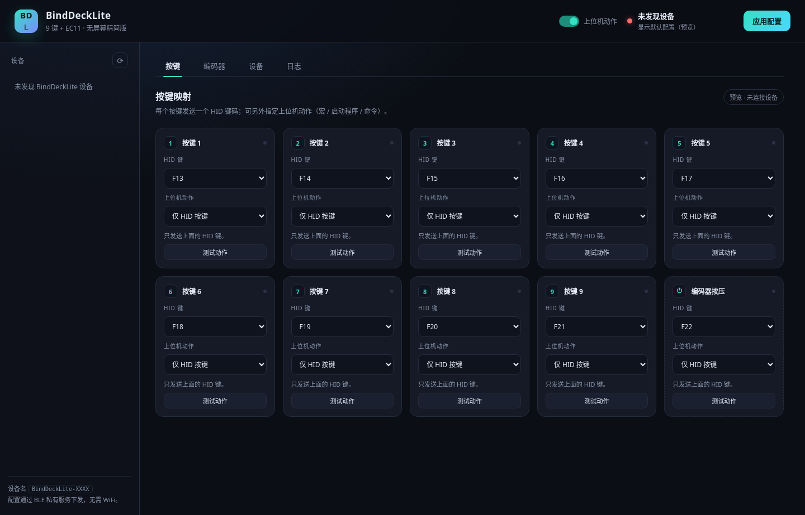

# BindDeckLite

BindDeckLite 是 [BindDeck](https://github.com/bbllmaster/BindDeck) 的精简版本：**去掉 OLED、去掉菜单键，9 个按键 + EC11 旋转编码器，支持 ESP32 与 ESP32-C3**，并重新设计了上位机。

固件与上位机共用同一套 `CFG:` / `CMD:` 行协议，按键既可以只发 HID（设备独立工作），也可以叠加运行上位机动作（宏、启动程序、执行命令）。

## 与 BindDeck 的差异

| 项目 | BindDeck | BindDeckLite |
|------|----------|--------------|
| 显示屏 | SSD1306 / SH1106 / SH1107 | **无**（无 I2C、无显示库） |
| 菜单键 | 独立 GPIO4 | **取消**（编码器长按替代） |
| 按键 | 8 个 + 编码器按压 | **9 个 + 编码器按压** |
| 编码器 | EC11（旋转 + 按压） | EC11（旋转 + 按压） |
| 芯片 | ESP32 / ESP32-C3 | ESP32 / ESP32-C3 |
| 配置方式 | 上位机 / OLED 菜单 / 配网页面 | **上位机 / 配网页面** |
| 固件环境 | 5 个（含 3 种屏幕） | **2 个**（`esp32dev` / `esp32c3`） |

## 硬件

### 默认引脚

| 功能 | ESP32（经典） | ESP32-C3 |
|------|---------------|----------|
| 按键 1–9 | 13, 12, 14, 27, 32, 33, 25, 26, 4 | 0, 1, 2, 3, 4, 5, 6, 7, 8 |
| EC11 CLK (A) | 18 | 20 |
| EC11 DT (B) | 19 | 21 |
| EC11 按压 (SW) | 5 | 10 |

- 按键接 **GPIO 与 GND**，固件启用内部上拉，按下为低电平。
- EC11 的 A/B 两相各接一个 GPIO 与 GND，公共端接 GND；按压开关一端接 SW，一端接 GND。
- 引脚可在上位机「设备 → 按键引脚」里改成实际接线，应用后写入 NVS。
- 经典 ESP32 避开 **GPIO6–11**（SPI Flash）与 **GPIO34–39**（仅输入、无上拉）。
- ESP32-C3 避开 **GPIO11–17**（内置 Flash）与 **GPIO18/19**（USB-CDC）；可用引脚只有 0–10、20、21。本板预设：9 键 = GPIO0–8，编码器按压 = GPIO10，编码器 A/B = GPIO20/21。
- ESP32-C3 深度睡眠只能被 **GPIO0–5** 上的按键唤醒；其他按键需要重新上电。
- C3 的 GPIO8/GPIO9 是启动 strapping 脚：9 号按键在 GPIO8 上，**上电时不要按住 9 号键**，否则会进入下载模式。

### 输入编号

| 编号（`BTN:` 消息） | 输入 |
|---------------------|------|
| 0–8 | 按键 1–9 |
| 9 | 编码器按压 |

默认键码：按键 1–9 = `F13`–`F21`，编码器按压 = `F22`。

## 固件

依赖 [PlatformIO](https://platformio.org/)。

固件基于 **Arduino core 3.x**：`platformio.ini` 通过 URL 固定
[pioarduino](https://github.com/pioarduino/platform-espressif32) 平台 `55.03.312`
（Arduino 3.3.12 / ESP-IDF 5.5.5），BLE 使用 **NimBLE-Arduino 2.x**。首次构建会自动下载
对应的平台、工具链与依赖库。

```bash
pio run -e esp32dev          # 经典 ESP32
pio run -e esp32c3           # ESP32-C3（4 MB，带 OTA）
pio run -e esp32c3_2mb       # ESP32-C3（2 MB，单 app 槽，无 OTA）
pio run -e esp32dev -t upload
```

> **Flash 容量必须匹配**：分区表里任何分区的结束地址超过芯片实际容量，bootloader 会判定整张表无效并静默复位（Arduino 2.0.17 的 bootloader 日志级别为 None）。4 MB 表含 `app1@0x200000`，2 MB 模块请用 `esp32c3_2mb`。

### 16 MB 模块的 bootloader

Arduino 自带的 bootloader 是按 4 MB flash 编译的，16 MB 模块会静默复位（WS-278）。
`bl_idf/` 用同一套 ESP-IDF 5.5.5 单独构建 16 MB bootloader（`CONFIG_SPI_FLASH_ROM_IMPL=y`、
16 MB flash 头、DIO 40 MHz）：

```bash
pio run -d bl_idf -e idf        # -> bl_idf/.pio/build/idf/bootloader.bin
```

`tools/build_release.py` 打包 `c3_16mb` 的 merged 镜像时会自动构建并使用它，并校验镜像头
确实是 16 MB；`pio run -e esp32c3_16mb -t upload` 仍会用 Arduino 自带的 4 MB bootloader，
**16 MB 板请刷 merged 包**（从 `0x0` 写入）。

### 发布包

```bash
python tools/build_release.py
```

输出到 `dist/`：

| 文件 | 用途 |
|------|------|
| `merged_binddecklite_esp32_vX.Y.Z.bin` | 经典 ESP32 整片烧录，从 `0x0` 写入 |
| `merged_binddecklite_c3_vX.Y.Z.bin` | C3 整片烧录，从 `0x0` 写入 |
| `ota_binddecklite_esp32_vX.Y.Z.bin` | 经典 ESP32 OTA / app-only |
| `ota_binddecklite_c3_vX.Y.Z.bin` | C3 OTA / app-only |

```bash
esptool.py --chip esp32   write_flash 0x0 merged_binddecklite_esp32_v1.0.0.bin
esptool.py --chip esp32c3 write_flash 0x0 merged_binddecklite_c3_v1.0.0.bin
```

### 配网 / OTA 模式

没有菜单键，进入配网模式有两种方式：

1. **上电时按住编码器按压键**约 0.2 秒；
2. 正常使用时**在 1.2 秒内连按两次编码器按压键**（设备会重启进入配网），或在上位机点「进入配网模式」。

进入后设备开启热点 `BindDeckLite-XXXX`（开放网络），浏览器打开 <http://192.168.4.1>：

- 配置 WiFi（保存后可用 UDP 通道）
- 修改 9 个按键引脚、编码器模式、休眠
- **固件 OTA 升级**：只能上传 `ota_*.bin`（app-only），不要上传 merged 整片包

退出：长按编码器约 1 秒，或 5 分钟自动关闭 WiFi。BLE 在配网模式期间关闭（与热点共用 2.4G 射频），退出后自动恢复。

### 主机绑定（WS-321）

首个连接并订阅 HID 输入报告的主机会被**绑定**到设备：固件在 NVS 记录其 identity address（`peer_id_addr`，无效时用 `peer_ota_addr` 归一化），重启后仍然有效。绑定后只有该主机能发送 HID 按键；其他 central（手机等）的 HID 订阅会被拒绝，但同一连接上的 CFG 配置通道不受影响。

三种清除方式：

1. **上位机**：设备页「清除主机绑定」按钮，通过 `CMD:CLEARBOND` 下发；
2. **上电长按**：按住编码器按压键 **5 秒**（与 0.2 秒配网、1.2 秒双击配网区分），只清除绑定、不进入配网；
3. 设备恢复出厂（NVS 擦除）后自动解除。

查询绑定状态用 `CMD:GET_BOND`，设备返回 `BOND_STATUS:bound,<脱敏地址>` 或 `BOND_STATUS:unbound`。地址只保留前两字节，完整 BLE 地址不会离开设备。

清除是立即生效的：旧的已连接主机不会被强行断开（避免操作过程中键盘失效），但下一台发来 HID 订阅的主机会直接接管并成为新的绑定主机，不需要给设备重新上电。

### 串口协议

经典 ESP32 的 USB 串口（115200）与 BLE CFG 服务、WiFi UDP 使用同一套行协议，详见 [docs/protocol.md](docs/protocol.md)。

## 上位机

`host/` 是重新设计的控制台（Flask + 原生 JS，无构建步骤）：



- 自动发现并连接所有 `BindDeckLite-XXXX`
- 10 个输入（9 键 + 编码器按压）的 HID 键码与上位机动作
- 编码器 5 种模式（音量 / 缩放 / 标签页 / 撤销重做 / 应用音量）
- 引脚、休眠配置，一键下发
- 实时按键高亮与日志、Ping、重启、进入配网

### 运行

```bash
cd host
python -m pip install -r requirements.txt
python app.py
```

浏览器自动打开 <http://127.0.0.1:8788>。

- Windows 宏动作需要 `pip install keyboard`；未安装时宏与媒体键不可用，其他功能不受影响。
- 设备同时只能被一个 BLE central 作为 HID 主机（首个订阅者被绑定，详见「主机绑定」一节）；配置通道是同一连接上的第二个 GATT 服务，不需要断开。
- 上位机配置保存在 `host/config.json`（运行时生成，不入库）。

### Windows 桌面版（exe / 托盘 / 开机自启动）

在 Windows 上运行 `host/build.bat`，得到单文件 `host\dist\BindDeckLite.exe`（Python 3.12 x64，目标机器无需安装 Python）：

```bat
cd host
build.bat
```

- exe 隐藏控制台窗口：双击后直接打开浏览器，并在任务栏右下角放一个托盘图标。
- 托盘菜单：**显示控制台**（单击托盘图标同样打开）与 **退出 BindDeckLite**。关闭浏览器标签页不会退出程序，退出请用托盘菜单。
- 如果机器上装不了 pystray / Pillow（或没有图形会话），不会隐藏控制台，也不会把程序留在无法退出的后台；「设备 → 桌面应用 → 退出上位机」始终可用。
- 重复双击 exe 不会启动第二份：检测到 8788 端口已监听时只打开浏览器。
- 「设备 → 桌面应用」可开关 **开机自启动** 与 **开机启动时最小化到托盘**。自启动方式：
  Windows 写 `HKCU\Software\Microsoft\Windows\CurrentVersion\Run`，Linux 写 `~/.config/autostart/binddecklite.desktop`，macOS 写 `~/Library/LaunchAgents/com.binddecklite.host.plist`。
- 配置、BLE 缓存与日志保存在 exe 同目录（目录不可写时退到 `%LOCALAPPDATA%\BindDeckLite`）：`config.json`、`ble_cache.json`、`host.log`。
- 源码模式也能体验托盘：`python app.py --desktop`；`--minimized` 表示不自动打开浏览器。`run.sh` / `run.bat` 行为不变（控制台运行，无托盘）。

> PyInstaller 不支持交叉编译，exe 必须在 Windows 上构建。仓库里的
> `.github/workflows/build-host.yml` 可手动触发（workflow_dispatch）或在 PR
> 时自动构建，构建完成后从 Actions 页面下载 `BindDeckLite-windows` 产物。

### 上位机动作

每个按键可单独配置：

| 类型 | 说明 |
|------|------|
| 仅 HID 按键 | 设备自己发键，上位机不做任何事 |
| 启动程序 / 文件 | 本地路径；可用「浏览…」调系统文件对话框，最近用过的路径会出现在输入框候选里（Windows 用 `os.startfile`） |
| 打开网址 | 默认浏览器 |
| 执行命令 | `shell=True`，请只填可信命令 |
| 媒体键 | 音量 / 播放 / 上下曲（需 `keyboard`） |
| 宏 | 每行一步：`key:ctrl+alt+t`、`text:hello`、`wait:200`；键名可用 `Tab` / `PageUp` / `LCtrl` 等界面名称（对照表见上位机右上角「帮助」） |

> 上位机动作默认开启，可在右上角关闭；关闭后设备仍然正常发 HID 键。

## 目录结构

```
├── platformio.ini
├── partitions/            # OTA 分区表（ESP32 / C3）
├── src/
│   ├── main.cpp           # Lite 固件：9 键 + EC11，无显示
│   ├── nimble_hid.*       # NimBLE HID + 唯一身份 / IRK（复用 BindDeck）
│   └── ble_config.*       # BLE CFG/CMD 服务（复用 BindDeck）
├── host/
│   ├── app.py             # 上位机后端（--desktop 进入托盘模式）
│   ├── desktop.py         # 托盘图标、控制台隐藏、原生文件对话框
│   ├── autostart.py       # 开机自启动（注册表 / XDG / LaunchAgent）
│   ├── app.spec           # PyInstaller 打包配置（唯一入口）
│   ├── build.bat          # Windows 一键打包 exe
│   ├── requirements.txt           # 运行必需（Flask / bleak）
│   ├── requirements-desktop.txt   # 托盘与文件对话框（pystray / pillow）
│   ├── requirements-build.txt     # 打包依赖（含 PyInstaller）
│   ├── ble_link.py        # BLE 扫描 / 多设备连接（复用 BindDeck）
│   ├── assets/app.ico     # exe / 托盘图标（python tools/make_icon.py 生成）
│   ├── templates/index.html
│   └── static/{app.js,style.css}
├── tools/build_release.py # 构建 merged + OTA 发布包
├── tools/make_icon.py     # 生成 host/assets/app.ico（纯标准库）
└── docs/protocol.md
```

## 版本与发布

固件发布沿用 BindDeck 的做法：项目里单独有一个**滚动固件发布任务**，每个版本的 merged / OTA 包以附件形式追加在该任务下，源码提交与版本说明也记录在那里。

- 固件版本：`src/main.cpp` 的 `FW_VERSION`
- 发布流程：改版本号 → `python tools/build_release.py` → 提交代码 → 把 `dist/` 里的 4 个 bin 追加到发布任务

## 许可

与上游 BindDeck 保持一致。
