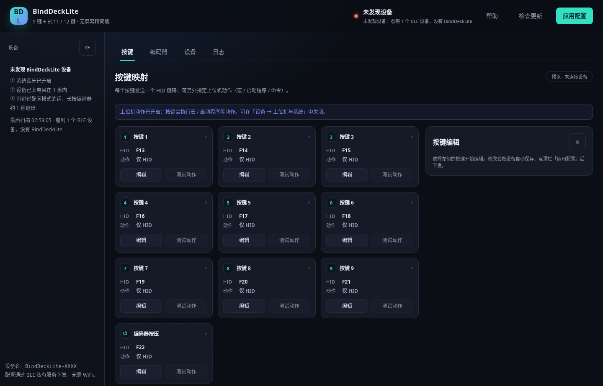

# BindDeckLite

BindDeckLite 是一套面向桌面工作流的**实体宏键盘方案**：9 个按键 + 1 个 EC11 旋转编码器（按压作为第 10 个输入），基于 ESP32 / ESP32-C3，通过 BLE HID 直接向电脑发键，目标机器不需要安装驱动或常驻服务。

它适合把每天重复的操作——启动程序、打开网址、执行命令、媒体控制、按键宏——放到手边的实体按键上；编码器负责音量、缩放、标签页切换这类连续调节。设备可以完全独立地发 HID 键，也可以叠加运行上位机动作。

同一套固件还支持**12 键布局**：把编码器的按压 / A / B 三根线各接一个按键，共 12 个输入。切换方式是上位机「设备 → 按键布局」或配网页的「按键布局」，默认仍是 9 键 + 编码器（WS-499）。

固件与上位机共用同一套 `CFG:` / `CMD:` 行协议，按键既可以只发 HID（设备独立工作），也可以叠加运行上位机动作（宏、启动程序、执行命令）。

## 特性概览

| 项目 | 说明 |
|------|------|
| 输入 | 9 个按键 + 编码器按压（第 10 输入）；可切 12 键布局 |
| 编码器 | EC11，5 种模式：音量 / 缩放 / 标签页 / 撤销重做 / 上位机动作 |
| 芯片 | 经典 ESP32、ESP32-C3（4 MB 与 16 MB 两种布局） |
| 连接 | BLE HID（NimBLE），首个订阅 HID 的主机被绑定 |
| 配置 | 上位机或网页配网，写入 NVS；引脚可改 |
| 协议 | `CFG:` / `CMD:` / `BTN:` / `ENC:` 行协议，BLE / 串口 / UDP 通用 |
| 上位机 | Flask + 原生 JS，无构建步骤；支持程序 / 网址 / 命令 / 媒体键 / 宏 |
| 升级 | 网页 OTA（app-only）与 merged 整片烧录 |

## 硬件

### 默认引脚

| 功能 | ESP32（经典） | ESP32-C3 |
|------|---------------|----------|
| 按键 1–9 | 13, 12, 14, 27, 32, 33, 25, 26, 4 | 0, 1, 2, 3, 4, 5, 6, 7, 8 |
| EC11 CLK (A) | 18 | 20 |
| EC11 DT (B) | 19 | 21 |
| EC11 按压 (SW) | 5 | 10 |

- 按键接 **GPIO 与 GND**，固件启用内部上拉，按下为低电平。
- **12 键版本**：上表的 EC11 CLK / DT / 按压三脚各接一个按键（不再接编码器），即 12 个按键；引脚校验在 12 键布局下允许占用这三脚。
- EC11 的 A/B 两相各接一个 GPIO 与 GND，公共端接 GND；按压开关一端接 SW，一端接 GND。
- 引脚可在上位机「设备 → 按键引脚」里改成实际接线，应用后写入 NVS。
- 经典 ESP32 避开 **GPIO6–11**（SPI Flash）与 **GPIO34–39**（仅输入、无上拉）。
- ESP32-C3 避开 **GPIO11–17**（内置 Flash）与 **GPIO18/19**（USB-CDC）；可用引脚只有 0–10、20、21。本板预设：9 键 = GPIO0–8，编码器按压 = GPIO10，编码器 A/B = GPIO20/21。
- **经典 ESP32 深度睡眠**（1.3.9 起）：只有当前布局里**第一个可唤醒输入**能单键唤醒（默认按键 1 = GPIO13，`ext0`）；其余 RTC 按键要靠 `ext1` 的 `ALL_LOW`，即**同时按住**才唤醒；非 RTC 脚（编码器脚的 GPIO5/18/19、12 键布局的第 10–12 键）不能唤醒。唤醒脚集合为空时固件不进入深睡。
- ESP32-C3 深度睡眠只能被 **GPIO0–5** 上的按键唤醒，每颗都单键生效；其他按键需要重新上电。
- C3 的 GPIO8/GPIO9 是启动 strapping 脚：9 号按键在 GPIO8 上，**上电时不要按住 9 号键**，否则会进入下载模式。

### 输入编号

| 编号（`BTN:` 消息） | 编码器布局（默认） | 12 键布局 |
|---------------------|--------------------|-----------|
| 0–8 | 按键 1–9 | 按键 1–9 |
| 9 | 编码器按压 | 按键 10（原按压脚，同一根线） |
| 10 | —（`ENC:` 旋转） | 按键 11（原 A 相） |
| 11 | —（`ENC:` 旋转） | 按键 12（原 B 相） |

默认键码：编码器布局为 `F13`–`F22`；12 键布局顺延到 `F13`–`F24`（第 11/12 键 = `F23`/`F24`）。12 键布局下不发送 `ENC:`。

每个输入 = **修饰键组合 + 主键**：在上位机按键抽屉里勾 Ctrl / Shift / Alt / Win 后，组合键由设备自己发出，不需要上位机在线（锁屏、登录界面、只配对 BLE 的电脑同样生效）。主键为「不发键」时修饰键也不发。

键码 `0` = **不发键**：该输入只跑上位机动作（启动程序 / 网址 / 命令 / 媒体键 / 宏），设备不发任何 HID。上位机下拉里在「特殊」分组里选；固件 **v1.3.8 起**完全静默，更早的固件会多发一帧全 0 报告（OS 不会据此输入字符）。

配网手势固定用第 10 个输入（编码器布局 = 编码器按压，12 键布局 = 第 10 键），两种布局完全一致。

## 固件

依赖 [PlatformIO](https://platformio.org/)。

固件基于 **Arduino core 3.x**：`platformio.ini` 通过 URL 固定
[pioarduino](https://github.com/pioarduino/platform-espressif32) 平台 `55.03.312`
（Arduino 3.3.12 / ESP-IDF 5.5.5），BLE 使用 **NimBLE-Arduino 2.x**。首次构建会自动下载
对应的平台、工具链与依赖库。

```bash
pio run -e esp32dev          # 经典 ESP32
pio run -e esp32c3           # ESP32-C3（4 MB，带 OTA）
pio run -e esp32c3_16mb      # ESP32-C3（16 MB）
pio run -e esp32dev -t upload
```

> **Flash 容量必须匹配**：分区表里任何分区的结束地址超过芯片实际容量，bootloader 会判定整张表无效并静默复位（Arduino 2.0.17 的 bootloader 日志级别为 None）。4 MB 表含 `app1@0x200000`，C3 只支持 **4 MB** 与 **16 MB** 两种版本；**2 MB 模块已不再支持**（`esp32c3_2mb` 环境与对应发布产物已移除）。

### 16 MB 模块的 bootloader

Arduino 自带的 bootloader 是按 4 MB flash 编译的，16 MB 模块会静默复位（WS-278）。
`bl_idf/` 用同一套 ESP-IDF 5.5.5 单独构建 16 MB bootloader（`CONFIG_SPI_FLASH_ROM_IMPL=y`、
16 MB flash 头、DIO 40 MHz）：

```bash
pio run -d bl_idf -e idf        # -> bl_idf/.pio/build/idf/bootloader.bin
```

`tools/build_release.py` 打包 `c3_16mb` 的 merged 镜像时会自动构建并使用它，并校验镜像头
确实是 16 MB；`pio run -e esp32c3_16mb -t upload` 仍会用 Arduino 自带的 4 MB bootloader，
**16 MB 板请刷 merged 包**（从 `0x0` 写入）。

### 发布包

```bash
python tools/build_release.py
```

输出到 `dist/`：

| 文件 | 用途 |
|------|------|
| `merged_binddecklite_esp32_vX.Y.Z.bin` | 经典 ESP32 整片烧录，从 `0x0` 写入 |
| `merged_binddecklite_c3_vX.Y.Z.bin` | C3 整片烧录，从 `0x0` 写入 |
| `ota_binddecklite_esp32_vX.Y.Z.bin` | 经典 ESP32 OTA / app-only |
| `ota_binddecklite_c3_vX.Y.Z.bin` | C3 OTA / app-only |

```bash
esptool.py --chip esp32   write_flash 0x0 merged_binddecklite_esp32_v1.0.0.bin
esptool.py --chip esp32c3 write_flash 0x0 merged_binddecklite_c3_v1.0.0.bin
```

### 配网 / OTA 模式

进入配网模式有两种方式：

1. **上电时按住第 10 个输入**（编码器布局 = 编码器按压键；12 键布局 = 第 10 键）约 0.2 秒；
2. 正常使用时**在 1.2 秒内连按两次**该键（设备会重启进入配网），或在上位机点「进入配网模式」。

进入后设备开启热点 `BindDeckLite-XXXX`（开放网络），浏览器打开 <http://192.168.4.1>：

- 配置 WiFi（保存后可用 UDP 通道）
- **连接结果自动更新（WS-610）**：保存 WiFi 后状态行会从「正在连接 SSID…」自己走到「已连接 SSID · IP」或失败原因，不用手动刷新；失败会给出原因和「重试连接」按钮，点一下就用已保存的密码重连、无需重输
- **密码不回显**：已保存的 WiFi 密码不会写进页面，密码框留空保存即「不修改」；要换密码直接输入新的即可（忘记原密码也不用先清空）
- 修改按键布局（编码器 / 12 键）、9 个按键引脚、编码器模式、休眠；12 键布局下第 10–12 键固定为原来编码器的三脚，页面上只读展示
- **按键自检**：表格上方的自检区会显示「最近触发：按键 N（GPIO X）」，并按下的那一行左侧亮绿边、行尾标「已触发 · GPIO X」（1.5 秒后褪去）；填完引脚直接按键就知道接对没有，不用退出配网开上位机
- **未保存提示**：WiFi 和按键接线是两个独立表单，保存其中一个会重新加载页面。改过还没保存时标题下会显示「有未保存的修改：…」，点另一个表单的保存按钮会先点名提示会丢掉什么，退出前也会列出还没保存的内容（WS-572）
- **固件 OTA 升级**：只能上传 `ota_*.bin`（app-only），不要上传 merged 整片包；页面上会显示上传进度与结果（写入与校验阶段、成功/失败卡片及错误码中文解释）
- **配网倒计时（WS-602）**：页面顶部显示「配网模式剩余 4:32 · 到时自动关闭热点」，逐秒递减（数字以设备为准，页面只在两次轮询之间递减）；剩余 ≤60 秒整行变琥珀并显示「即将关闭」。点右侧「延长 5 分钟」不重载页面，已填的 SSID / 引脚 / OTA 文件都保留；单次配网最多延长到「进入配网 + 30 分钟」，到上限后按钮置灰提示退出后重新进入。超时后页面最上方出现红色块说明热点已关闭，需重新按住第 10 个输入上电进入

退出：长按编码器约 1 秒，或 5 分钟自动关闭 WiFi，或直接点页面底部「完成配置 → 退出配网并重启」（手机上就能结束配网，设备会先回结果页再重启）。页面顶部显示剩余时间，可延长 5 分钟，单次最迟 30 分钟；即使不开页面，到点仍会自动退网。BLE 在配网模式期间关闭（与热点共用 2.4G 射频），退出后自动恢复。

### 主机绑定（WS-321）

首个连接并订阅 HID 输入报告的主机会被**绑定**到设备：固件在 NVS 记录其 identity address（`peer_id_addr`，无效时用 `peer_ota_addr` 归一化），重启后仍然有效。绑定后只有该主机能发送 HID 按键；其他 central（手机等）在配对完成的瞬间就会被断开，**CFG 配置通道同样只对绑定主机开放**——否则任何刚配对的手机都能改引脚、切模式、重启设备。

### 蓝牙配置模式（换绑，WS-419c）

换电脑时不用先清绑定：**上电时按住「编码器按压 + 按键 1」约 0.2 秒**，设备进入蓝牙配置模式，开一个 **2 分钟**的窗口：

- 窗口内任何主机都可以配对并接管绑定，接管发生在它**真正订阅 HID 输入**的那一刻；
- 在此之前、以及窗口超时无人接管时，**原绑定一直有效**，旧电脑照常能用；
- 旧绑定被替换后，旧主机再连会被当成陌生设备断开；
- 这个手势优先于「0.2 秒进配网」和「5 秒清绑定」。

三种清除方式：

1. **上位机**：设备页「清除主机绑定」按钮，通过 `CMD:CLEARBOND` 下发；
2. **上电长按**：按住编码器按压键 **5 秒**（与 0.2 秒配网、1.2 秒双击配网区分），只清除绑定、不进入配网；
3. 设备恢复出厂（NVS 擦除）后自动解除。

查询绑定状态用 `CMD:GET_BOND`，设备返回 `BOND_STATUS:bound,<脱敏地址>` 或 `BOND_STATUS:unbound`。地址只保留前两字节，完整 BLE 地址不会离开设备。

清除是立即生效的：**设备的绑定被清空，同时旧主机的连接会被主动断开**（`CONN_TERM_LOCAL`），之后第一台发来 HID 订阅的主机会接管并成为新的绑定主机，不需要给设备重新上电。

### 串口协议

经典 ESP32 的 USB 串口（115200）与 BLE CFG 服务、WiFi UDP 使用同一套行协议，详见 [docs/protocol.md](docs/protocol.md)。

## 上位机

`host/` 是配套的上位机控制台（Flask + 原生 JS，无构建步骤）：



- 自动发现并连接所有 `BindDeckLite-XXXX`
- 10 个输入（9 键 + 编码器按压）的 HID 键码与上位机动作
- 编码器 5 种模式（音量 / 缩放 / 标签页 / 撤销重做 / 上位机动作）
- 引脚、休眠配置，一键下发
- 实时按键高亮与日志、Ping、重启、进入配网
- 设备页「运行状态」：运行时长、上次复位原因、NVS、空闲堆（`CMD:SYSINFO`）

### 运行

```bash
cd host
python -m pip install -r requirements.txt
python app.py
```

浏览器自动打开 <http://127.0.0.1:8788>。

- Windows 宏动作需要 `pip install keyboard`；未安装时宏与媒体键不可用，其他功能不受影响。
- 设备同时只能被一个 BLE central 作为 HID 主机（首个订阅者被绑定，详见「主机绑定」一节）；配置通道是同一连接上的第二个 GATT 服务，不需要断开。
- 上位机配置保存在 `host/config.json`（运行时生成，不入库）。

**本机存档与设备配置的关系**：`config.json` 存在 exe / `app.py` 同目录，换目录、换电脑或重装系统都等于一份空存档。上位机第一次看到某台设备时，服务端会生成一份**本机默认配置**（默认引脚、F13–F24 键码），它不一定等于设备 NVS 里正在用的配置；此时页签下方会显示琥珀色提示条「本机没有这台设备的配置存档 · 现在显示的是默认值」。点「从设备读取」（或设备页的「读取设备配置」）会用设备的真实值覆盖表单并把该设备标记为可信；在此之前点「应用配置」会先弹一次确认，取消则一条 `CFG:` 都不发。老版本留下的 `config.json` 没有这个标记，按「可信」处理，不额外提示。

设备断线重连（例如在手机配网页改完引脚、编码器模式或休眠后退出配网）时，上位机会等连接稳定 2 秒后自动以设备当前值为准刷新表单并记一行「已按设备同步」；如果本机还有没点「应用配置」的修改，则只提示（顶栏琥珀点 + 设备页说明）、不覆盖也不替你下发。

### 备份与迁移（动作导出 / 导入）

每个输入的「上位机动作」（宏 / 启动程序 / 打开网址 / 执行命令 / 媒体键）只存在本机 `config.json`，设备与 `CFG:` 协议里都没有第二份副本。换目录、换电脑或重装系统前，用设备页「通信与配置 → 备份与迁移」把动作备份出来：

- **导出动作…**：弹出系统「保存到…」对话框（默认名 `BindDeckLite-<设备名>-YYYYMMDD-HHMM.json`）。文件只含 schema 版本、生成时间、来源设备名 / 芯片 / 布局、每个输入的 `code` / `mods` / `action`，以及编码器两个方向的动作。**不含** dev_id、蓝牙地址、任何 WiFi 凭据，也不含引脚 / 休眠 / 全局设置。
- **导入动作…**：选择一份 JSON 后先预览——文件名、来源、时间、将覆盖的输入数、按类型计数，并逐条列出会执行的命令 / 路径 / 网址；宏只显示逐步摘要，`text:` / `paste:` 正文只显示长度、不回显明文。底部有必读风险提示。

导入**只改本机存档**：按输入编号覆盖、文件里没有的输入保持原值，绝不发 `CFG:`、不自动执行动作、不影响其它设备，也**不会**自动「应用配置」。确认导入后顶栏会显示「有未下发修改」，要手动点一次「应用配置」才会把键码与修饰键下发到设备。设备离线时也能导入，导入后徽标提示未下发。

坏文件（截断 / 非 JSON / 版本不认识 / 动作类型或宏步骤未知 / 单文件 > 512 KB / 输入超过 12 项）会**整份拒绝**并给出中文原因（点名第几个输入），`config.json` 一个字段都不改。取消选择或取消预览不会发请求、不写日志、不改配置。12 键布局导出的文件导到 10 输入设备时，前 10 个生效，第 11–12 个照常保存、暂不显示，预览会说明「切换为 12 键布局后生效」。

### 连不上时看哪里

上位机会把「为什么连不上」直接写在界面上，不用去翻控制台：

| 位置 | 显示什么 |
| --- | --- |
| 顶栏第二行 | 蓝牙依赖不可用 / 未连接的原因 / 扫描结论（没扫到设备时给出原因） |
| 左侧设备列表 | 条目显示失败原因摘要（悬停看全文），状态点变琥珀色 |
| 左侧空状态 | 三行自检（蓝牙已开 / 已上电 / 退出配网模式）+ 最近一次扫描时间与结论 |
| 日志页 | `BLE` 事件：连接失败、原因变化、恢复连接各一条 |

常见结论与处理：

- **扫描未发现任何 BLE 设备**：系统蓝牙关闭、未授权，或设备没有广播 —— 先确认系统蓝牙已开、设备已上电。
- **看到 N 个 BLE 设备，没有 BindDeckLite**：蓝牙正常，但设备没在广播 —— 确认设备已上电并靠近；刚进过配网模式的话长按编码器约 1 秒退出。
- **配对失败：请在系统蓝牙设置里删除该设备的旧配对后重试**：加密 / 认证失败 —— 先在系统蓝牙设置里移除该设备的旧配对记录。
- **设备不在广播范围（可能已断电或换了地址）**：设备掉线或换了地址 —— 给设备上电后重新扫描。

### Windows 桌面版（exe / 托盘 / 开机自启动）

在 Windows 上运行 `host/build.bat`，得到单文件 `host\dist\BindDeckLite.exe`（Python 3.12 x64，目标机器无需安装 Python）：

```bat
cd host
build.bat
```

- exe 隐藏控制台窗口：双击后直接打开浏览器，并在任务栏右下角放一个托盘图标。
- 托盘菜单：**显示控制台**（单击托盘图标同样打开）与 **退出 BindDeckLite**。关闭浏览器标签页不会退出程序，退出请用托盘菜单。
- 如果机器上装不了 pystray / Pillow（或没有图形会话），不会隐藏控制台，也不会把程序留在无法退出的后台；「设备 → 桌面应用 → 退出上位机」始终可用。
- 重复双击 exe 不会启动第二份：检测到 8788 端口已监听时只打开浏览器。
- 「设备 → 桌面应用」可开关 **开机自启动** 与 **开机启动时最小化到托盘**。自启动方式：
  Windows 写 `HKCU\Software\Microsoft\Windows\CurrentVersion\Run`，Linux 写 `~/.config/autostart/binddecklite.desktop`，macOS 写 `~/Library/LaunchAgents/com.binddecklite.host.plist`。
  Windows 若需要提权启动（让宏能输入到以管理员运行的程序），改用登录计划任务，见下方「以管理员身份运行」。
- 配置、BLE 缓存与日志保存在 exe 同目录（目录不可写时退到 `%LOCALAPPDATA%\BindDeckLite`）：`config.json`、`ble_cache.json`、`host.log`。
- 源码模式也能体验托盘：`python app.py --desktop`；`--minimized` 表示不自动打开浏览器。`run.sh` / `run.bat` 行为不变（控制台运行，无托盘）。

#### 以管理员身份运行（Windows）

**为什么需要**：Windows 的 UIPI 会拦截低完整性进程发往高完整性进程的 `SendInput`。上位机以普通权限运行时，宏能发到记事本、浏览器，却**输不进任何以管理员运行的程序**（任务管理器、部分游戏、管理员启动的编辑器）。`HKCU\...\Run` 只能启动普通权限进程，无法提权，所以这个模式改用**登录计划任务**：

```
schtasks /create /tn BindDeckLite /tr "<启动命令>" /sc onlogon /rl highest /f
```

- 任务名固定为 `BindDeckLite`，`/rl highest`（最高权限），登录时由计划任务服务拉起，**不弹 UAC**。
- 两种自启动方式**互斥**：开管理员模式会自动删掉 `HKCU\...\Run` 里的 `BindDeckLite` 值，关掉管理员模式（或改回普通自启动）会自动删掉计划任务。只有一个条目生效，否则登录时两个实例会抢 8788 端口。
- 非 Windows 平台没有这个选项（勾选框与整行都不显示）。
- 首次勾选前请确认当前账户是管理员组的成员，否则 `schtasks /rl highest` 会失败，界面上会直接报错。

**手动清理残留**（配置丢失、换机器或想彻底重来时）：

```bat
schtasks /query /tn BindDeckLite /xml     :: 看任务在不在、RunLevel 是不是 HighestAvailable
schtasks /delete /tn BindDeckLite /f      :: 删掉计划任务
```

再检查注册表 `HKEY_CURRENT_USER\Software\Microsoft\Windows\CurrentVersion\Run` 里是否还有名为 `BindDeckLite` 的值（有就删掉）。两边都清掉后，重新在「设备 → 桌面应用」里勾选即可。

> PyInstaller 不支持交叉编译，exe 必须在 Windows 上构建。仓库里的
> `.github/workflows/build-host.yml` 可手动触发（workflow_dispatch）或在 PR
> 时自动构建，构建完成后从 Actions 页面下载 `BindDeckLite-windows` 产物。

### 上位机动作

每个按键可单独配置：

| 类型 | 说明 |
|------|------|
| 仅 HID 按键 | 设备自己发键，上位机不做任何事 |
| 启动程序 / 文件 | 本地路径；可用「浏览…」调系统文件对话框，最近用过的路径会出现在输入框候选里（Windows 用 `os.startfile`） |
| 打开网址 | 默认浏览器 |
| 执行命令 | `shell=True`，请只填可信命令 |
| 媒体键 | 音量 / 播放 / 上下曲（需 `keyboard`） |
| 宏 | 每行一步：`key:ctrl+alt+t`、`text:hello`（逐字符，默认 20ms 间隔）、`text!80:hello`（自定义逐字符延迟毫秒）、`paste:文本`（走剪贴板 + Ctrl/Cmd+V，中文/符号/密码框用这个）、`wait:200`、`url:https://…`、`browser:chrome`（指定后续 `url:` 用 Chrome / Firefox / Edge / Safari，未安装时回退默认浏览器）、`app:C:\path\app.exe --arg`（启动桌面应用程序，支持 PATH 程序名与环境变量写法，含空格的路径/参数用引号包裹（如 `--title="My App"`），Windows 会等待窗口到前台）；键名可用 `Tab` / `PageUp` / `LCtrl` 等界面名称（对照表见上位机右上角「帮助」） |

> 上位机动作默认开启，可在右上角关闭；关闭后设备仍然正常发 HID 键。

> `paste:` 的剪贴板后端：Windows 用 ctypes 直接调 Win32 剪贴板 API（无新增依赖），macOS 用 `pbcopy` / `pbpaste`，Linux 依次尝试 `xclip` / `xsel` / `wl-copy`，都没有时回退 tkinter（需图形界面）；仍不可用时日志写「剪贴板不可用，paste 步骤跳过」并回退成逐字符输入，宏不会中断。粘贴后约 0.4 秒恢复原剪贴板里的文本内容（图片等非文本内容无法恢复）。

## 目录结构

```
├── platformio.ini
├── partitions/            # OTA 分区表（ESP32 / C3）
├── src/
│   ├── main.cpp           # 主固件：9 键 + EC11
│   ├── nimble_hid.*       # NimBLE HID + 唯一身份 / IRK
│   └── ble_config.*       # BLE CFG/CMD 服务
├── host/
│   ├── app.py             # 上位机后端（--desktop 进入托盘模式）
│   ├── desktop.py         # 托盘图标、控制台隐藏、原生文件对话框
│   ├── autostart.py       # 开机自启动（注册表 / XDG / LaunchAgent）
│   ├── app.spec           # PyInstaller 打包配置（唯一入口）
│   ├── build.bat          # Windows 一键打包 exe
│   ├── requirements.txt           # 运行必需（Flask / bleak）
│   ├── requirements-desktop.txt   # 托盘与文件对话框（pystray / pillow）
│   ├── requirements-build.txt     # 打包依赖（含 PyInstaller）
│   ├── ble_link.py        # BLE 扫描 / 多设备连接
│   ├── assets/app.ico     # exe / 托盘图标（python tools/make_icon.py 生成）
│   ├── templates/index.html
│   └── static/{app.js,style.css}
├── tools/build_release.py # 构建 merged + OTA 发布包
├── tools/make_icon.py     # 生成 host/assets/app.ico（纯标准库）
└── docs/protocol.md
```

## 版本与发布

固件与上位机按版本号发布：每个版本的 merged / OTA 包、SHA256 与版本说明统一记录在项目的**滚动固件发布任务**下，源码提交与版本号一一对应。

- 固件版本：`src/main.cpp` 的 `FW_VERSION`
- 发布流程：改版本号 → `python tools/build_release.py` → 提交代码 → 把 `dist/` 里的 4 个 bin 追加到发布任务

## 许可

本项目采用 [MIT License](LICENSE)。

Copyright (c) 2026 bbllmaster
